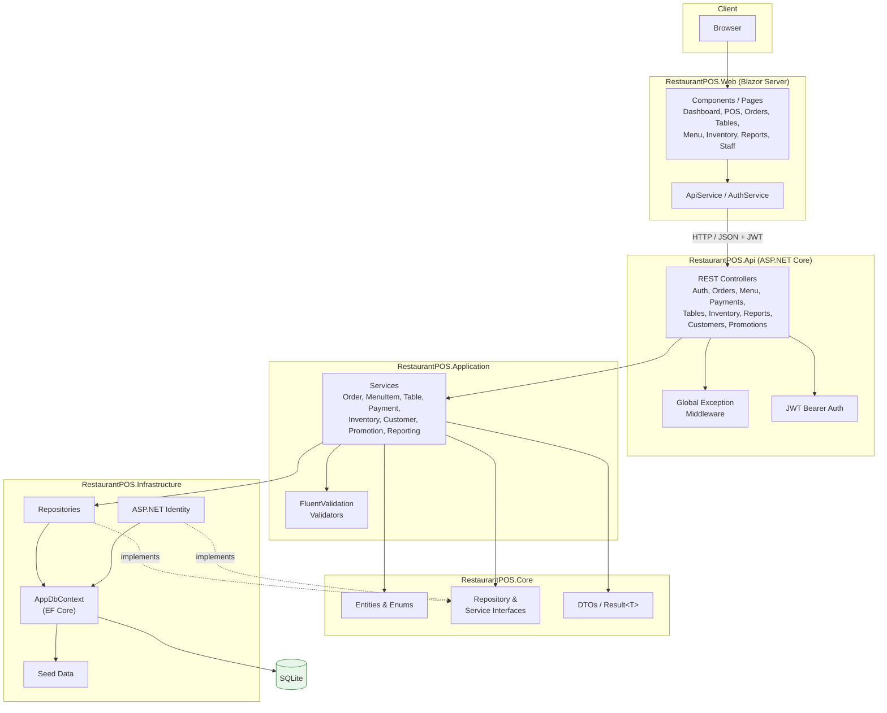
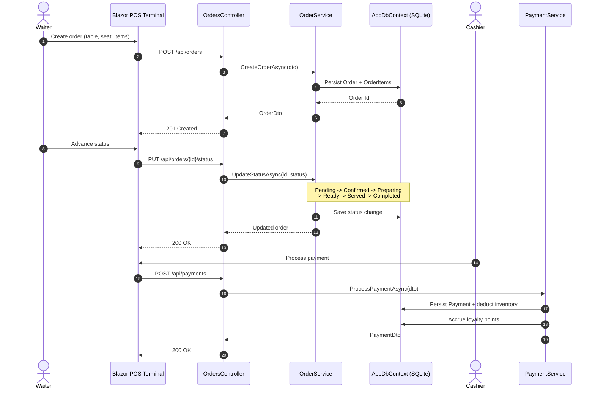
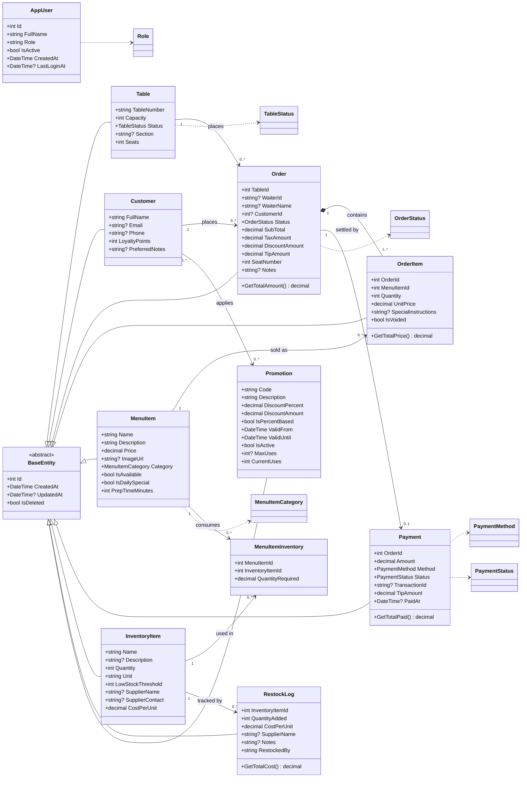
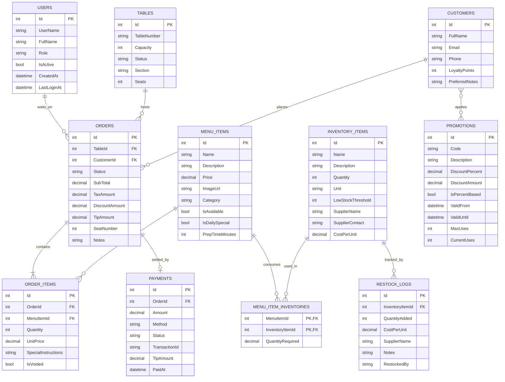

# RestaurantPOS


[](https://github.com/ogc16/restaurant-pos/actions/workflows/ci.yml)
[](LICENSE)
[](tests/)

A full-stack Restaurant Point of Sale system built with .NET 10, ASP.NET Core Web API, and Blazor Server.

> [Contributing](CONTRIBUTING.md) · [Code of Conduct](CODE_OF_CONDUCT.md) · [Security](SECURITY.md) · [License](LICENSE)

## Features

### Order Management
- Table and seat assignment
- Order status workflow: Pending -> Confirmed -> Preparing -> Ready -> Served -> Completed
- Split bills across multiple payments
- Order modifications and item voiding

### Menu Integration
- Dynamic menu with categories (Starters, Mains, Desserts, Drinks, Sides, Specials)
- Admin panel for adding/removing items and updating prices
- Daily specials and sold-out item handling

### Payment Processing
- Cash, credit/debit card, mobile money, PayPal support
- Tip entry and receipt generation
- Loyalty point accrual on payments

### Inventory Tracking
- Automatic ingredient deduction per order
- Low-stock and out-of-stock alerts
- Restock logging with supplier management

### User Roles & Authentication
- Role-based access: Admin, Cashier, Waiter
- ASP.NET Identity with JWT authentication
- Staff management with role updates, deactivation, and password changes

### Analytics & Reporting
- Daily, weekly, monthly sales reports
- Top-selling items and revenue tracking
- CSV export

### Customer Experience
- Customer profiles with loyalty points
- Loyalty point redemption
- Discount and promotion codes
- Repeat-visit preference tracking

## Tech Stack

| Layer | Technology |
|-------|-----------|
| Backend | ASP.NET Core 10 Web API |
| Frontend | Blazor Server (Interactive Server Rendering) |
| Database | SQLite + Entity Framework Core |
| Auth | ASP.NET Identity + JWT Bearer |
| Validation | FluentValidation |
| API Docs | Swagger / Swashbuckle |
| Testing | xUnit, FluentAssertions, WebApplicationFactory, InMemory EF Core |

## Architecture

Clean Architecture with 5 projects. Dependencies point inward: `Api` and `Web`
depend on `Application`, which depends on `Core`; `Infrastructure` implements the
interfaces defined in `Core`.

```
RestaurantPOS.Core           -> Domain entities, interfaces, DTOs, enums, pagination
RestaurantPOS.Infrastructure -> EF Core DbContext, repositories, Identity, seed data
RestaurantPOS.Application    -> Business logic, services, FluentValidation validators
RestaurantPOS.Api            -> REST controllers, JWT auth config, global error middleware
RestaurantPOS.Web            -> Blazor Server frontend, API client
```

### Component Diagram



### Order Lifecycle



### Domain Model



### Data Model (Entity-Relationship)



## Project Structure

```
POS/
├── src/
│   ├── RestaurantPOS.Core/
│   │   ├── Entities/        # MenuItem, Order, Table, Payment, Customer, etc.
│   │   ├── Enums/           # OrderStatus, PaymentMethod, TableStatus, etc.
│   │   ├── Interfaces/      # Repository contracts (with pagination)
│   │   ├── DTOs/            # Request/Response models
│   │   └── Common/          # Result<T>, BaseEntity, PaginatedRequest/Response
│   ├── RestaurantPOS.Infrastructure/
│   │   ├── Data/            # AppDbContext, SeedData
│   │   ├── Repositories/    # EF Core implementations
│   │   └── Identity/        # JWT auth + user management service
│   ├── RestaurantPOS.Application/
│   │   ├── Services/        # MenuItemService, OrderService, TableService, etc.
│   │   ├── Interfaces/      # Service contracts (with pagination)
│   │   └── Validation/      # FluentValidation validators (11 validators)
│   ├── RestaurantPOS.Api/
│   │   ├── Controllers/     # Auth, Orders, Menu, Payments, Tables, Inventory, Reports, Customers, Promotions
│   │   ├── Middleware/       # Global exception handling
│   │   └── Program.cs       # Startup configuration
│   └── RestaurantPOS.Web/
│       ├── Components/
│       │   ├── Pages/       # Dashboard, POS, Orders, Tables, Reports, etc.
│       │   └── Layout/      # MainLayout, NavMenu
│       └── Services/        # ApiService, AuthService
├── tests/
│   ├── RestaurantPOS.Application.Tests/  # 44 unit tests
│   └── RestaurantPOS.Api.Tests/          # 20 integration tests
├── Start-RestaurantPOS.bat   # Launch script
└── Stop-RestaurantPOS.bat    # Stop script
```

## Getting Started

### Prerequisites
- .NET 10 SDK

### Database Setup

The application uses **SQLite** with a local database file. The database is created automatically on first API startup, and seed data is applied via EF Core's `HasData` configuration.

No external database server is required.

### Run from Source

```bash
# Terminal 1 - Start API (port 7001)
dotnet run --project src/RestaurantPOS.Api

# Terminal 2 - Start Web UI (port 5001)
dotnet run --project src/RestaurantPOS.Web
```

### Run Compiled Executables

```cmd
# Double-click or run from command line
Start-RestaurantPOS.bat
```

### Endpoints

| URL | Description |
|-----|------------|
| http://localhost:5001 | Web UI |
| http://localhost:7001 | API |
| http://localhost:7001/swagger | Swagger docs |

## API Endpoints

| Method | Endpoint | Auth | Description |
|--------|----------|------|-------------|
| POST | `/api/auth/login` | None | Login and get JWT token |
| POST | `/api/auth/register` | None | Register new user |
| GET | `/api/auth/me` | Any | Get current user profile |
| GET | `/api/auth/users` | Admin | List all users |
| PUT | `/api/auth/users/{id}/role` | Admin | Update user role |
| PUT | `/api/auth/users/{id}/deactivate` | Admin | Deactivate user |
| PUT | `/api/auth/users/{id}/password` | Any | Change password |
| GET | `/api/menuitems` | None | List all menu items |
| POST | `/api/menuitems` | Admin | Create menu item |
| PUT | `/api/menuitems/{id}` | Admin | Update menu item |
| DELETE | `/api/menuitems/{id}` | Admin | Delete menu item |
| GET | `/api/orders` | Any | List all orders |
| POST | `/api/orders` | Any | Create new order |
| GET | `/api/orders/{id}` | Any | Get order by ID |
| PUT | `/api/orders/{id}/status` | Any | Update order status |
| POST | `/api/orders/{id}/apply-promotion` | Any | Apply promotion to order |
| GET | `/api/orders/{id}/receipt` | Any | Get order receipt |
| POST | `/api/orders/split` | Any | Split bill |
| GET | `/api/payments` | Admin | List payments |
| POST | `/api/payments` | Any | Process payment |
| GET | `/api/tables` | Any | List tables |
| GET | `/api/tables/available` | Any | List available tables |
| POST | `/api/tables` | Admin | Create table |
| GET | `/api/inventory` | Any | List inventory |
| GET | `/api/inventory/low-stock` | Any | List low-stock items |
| POST | `/api/inventory` | Admin | Create inventory item |
| POST | `/api/inventory/restock` | Admin | Restock item |
| GET | `/api/reports/daily` | Admin/Cashier | Daily sales report |
| GET | `/api/reports/export` | Admin/Cashier | Export CSV |
| GET | `/api/customers` | Any | List customers |
| POST | `/api/customers` | Any | Create customer |
| POST | `/api/customers/{id}/redeem` | Any | Redeem loyalty points |
| GET | `/api/promotions` | Any | List promotions |
| POST | `/api/promotions` | Admin | Create promotion |

## Frontend Pages

| Page | Route | Access |
|------|-------|--------|
| Dashboard | `/` | All |
| POS Terminal | `/pos` | All |
| Orders | `/orders` | All |
| Tables | `/tables` | All |
| Menu Management | `/menu` | Admin |
| Inventory | `/inventory` | Admin |
| Reports | `/reports` | Admin, Cashier |
| Customers | `/customers` | Admin |
| Promotions | `/promotions` | Admin |
| Staff | `/staff` | Admin |

## Testing

```bash
# Run all tests
dotnet test RestaurantPOS.slnx

# Run unit tests only
dotnet test tests/RestaurantPOS.Application.Tests/

# Run API integration tests only
dotnet test tests/RestaurantPOS.Api.Tests/
```

### Test Coverage
- **44 unit tests**: Service layer (MenuItem, Order, Table, Customer, Payment, Inventory, Promotion)
- **20 integration tests**: API endpoints (Auth, Menu, Orders, Tables, Payments, Inventory)

## Seed Data

The database is seeded with:

- **8 tables** across Indoor, Outdoor, Bar, and VIP sections
- **16 menu items** across Starters, Mains, Desserts, and Drinks
- **10 inventory items** with suppliers
- **23 menu-to-inventory links** for ingredient tracking
- **3 roles**: Admin, Cashier, Waiter
- **1 admin user**: admin@restaurant.com / Admin@123456

## Contributing

Contributions are welcome! Please read our [Contributing Guide](CONTRIBUTING.md) and
[Code of Conduct](CODE_OF_CONDUCT.md) before getting started.

## License

Distributed under the [GNU General Public License v3.0](LICENSE). See
[LICENSE](LICENSE) for the full text.
